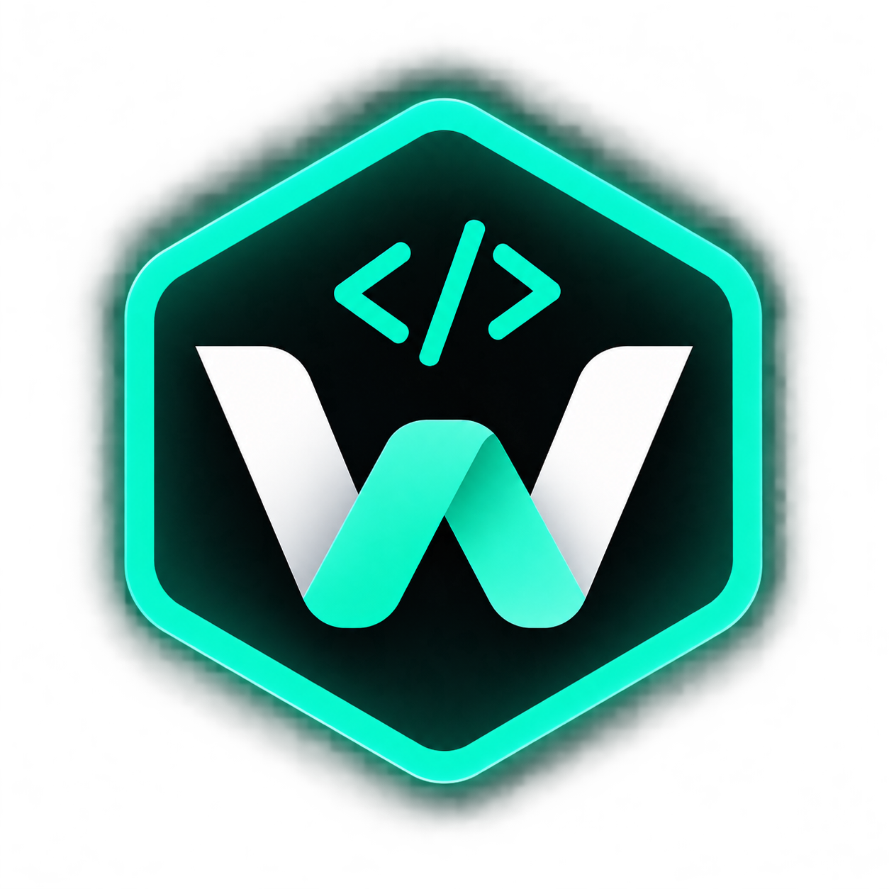
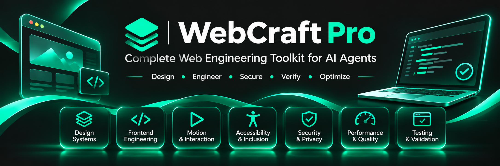

# WebCraft Pro — Engineering Toolkit for AI Agents

[](https://github.com/ViviBeri/webcraft-pro/actions/workflows/validate.yml)
[](https://github.com/ViviBeri/webcraft-pro/actions/workflows/security-audit.yml)
[](https://github.com/ViviBeri/webcraft-pro/actions/workflows/accessibility-check.yml)
[](https://github.com/ViviBeri/webcraft-pro/releases/latest)
[](https://opensource.org/licenses/MIT)
[](https://nodejs.org/)

**🌐 [View the official WebCraft Pro Website](https://viviberi.github.io/webcraft-pro/)**



**Design with intention. Engineer with discipline. Secure by default.**

WebCraft Pro is an open-source, framework-agnostic collection of **44 reusable Agent Skills**, shared engineering standards, practical examples, and verification workflows for building distinctive, accessible, performant, and secure web applications.

It provides AI coding agents with a structured engineering process covering the complete website delivery lifecycle—from initial design direction through implementation, accessibility, security, performance, browser QA, and release.


## QuickStart

Get up and running in 5 minutes. WebCraft Pro requires Node.js 22.12.0 or higher.

### 1. Install the skills

Run the published npm package directly in your project root:

```bash
npx webcraft-pro install --agent claude
```

Options: use `--agent copilot`, `--agent codex`, or `--agent all`. You can also use `--stage` or `--skills` for selective installation. Use `--dry-run` to preview changes before installing.

### 2. Use the skills

The installer places skill files in the agent-specific project directory:

- Claude Code: `.claude/skills/`
- OpenAI Codex: `.agents/skills/`
- GitHub Copilot: `.github/skills/`

File placement does not prove that an agent automatically discovers or invokes a skill. The current end-to-end compatibility status is **Not tested** for Claude Code, Codex, and GitHub Copilot. Check the [agent compatibility matrix](./docs/agent-compatibility.md) before relying on automatic discovery.

Open your AI coding agent in the project and, where the agent supports skill invocation, prompt it:

> Use WebCraft Pro to build a secure login form.

### 3. Verify the output

Run your project's standard linters and tests. Consult the relevant WebCraft Pro standards and skill verification guidance, then review the generated code before merging or releasing it.

## Why this exists (LLMs already know this)

LLMs are trained on extensive software-engineering material, including semantic HTML, accessibility, security, and performance practices. Knowing a rule is not the same as applying it consistently. Under context pressure, speed-oriented generation, ambiguous requirements, or hallucinated assumptions, an agent can still omit labels, choose non-semantic controls, skip focus states, or leave risky patterns unchecked.

WebCraft Pro does not claim to teach models facts they have never seen. It makes important requirements explicit through reusable skills and standards, then moves beyond instructions: repository validation, static audits, and browser-based tests provide evidence that selected requirements were actually checked. **The value is the guardrail and verification loop—not the prompt alone.**

The micro-benchmark in [examples/benchmark](./examples/benchmark/) illustrates a deliberately flawed raw React form beside an accessible, skill-guided version. The examples are illustrative—not captured model outputs—and are not yet an executable CI benchmark. The existing CI workflows enforce repository and keyboard/focus checks; the on-demand Playwright/axe-core checker can assess rendered pages. Automated, repeatable model evaluation is tracked in `TODO.md`.

## 1. Eight-stage architecture

WebCraft Pro organizes the engineering lifecycle into eight stages:

| Stage | Area | Purpose |
|---|---|---|
| 01 | Foundation and Agent Interoperability | Establish repository conventions, portable skills, installation, and shared agent instructions. |
| 02 | Design Intelligence | Define visual direction, design systems, hierarchy, and product-specific interfaces. |
| 03 | Frontend Engineering | Build maintainable components, responsive layouts, forms, and frontend architecture. |
| 04 | Motion and GSAP | Create purposeful animation, scroll experiences, and accessible motion systems. |
| 05 | Accessibility Engineering | Apply semantic HTML, keyboard navigation, screen-reader testing, and WCAG-oriented reviews. |
| 06 | Web and API Security | Address authentication, authorization, input handling, API risks, secrets, and security testing. |
| 07 | Performance Engineering | Measure and improve Core Web Vitals, rendering, JavaScript, images, fonts, and network delivery. |
| 08 | Browser Automation, QA and Release | Verify rendered experiences, browser behavior, accessibility checks, screenshots, and release readiness. |

The stage directories provide the roadmap, acceptance criteria, and supporting documentation. Canonical skills remain in `skills/`, avoiding duplicated skill instructions across stages and AI agents.

## 2. Automated quality and CI pipelines

WebCraft Pro includes complementary GitHub Actions workflows and browser verification tooling.

### Repository validation

The `Validate Repository` workflow checks:

- Skill metadata and required frontmatter.
- Skill directory and naming consistency.
- The canonical 44-skill inventory against README and skill-index entries.
- The routing evaluation corpus structure, prompt-to-skill mappings, and referenced skill directories.
- Eight-stage repository structure.
- Skill validator tests.
- Installer tests.

### Zero-dependency security pattern audit

The `Security Pattern Audit` workflow runs a Node.js static pattern scanner built using Node.js standard-library modules.

It scans Markdown code fences in:

- `skills/`
- `standards/`
- `examples/`

It checks for patterns including `eval()`, `new Function()`, unsafe `innerHTML` assignments, `document.write()`, potentially unsafe `href` values, and wildcard `postMessage()` origins.

The workflow tests the scanner, generates a JSON report, verifies the report, and uploads it as an artifact.

**Scope limitation:** This is a static Markdown code-example pattern audit—not a complete application security scanner or proof of security.

### Playwright accessibility keyboard tests

The `Accessibility Keyboard Tests` workflow installs Chromium and executes the Playwright keyboard/focus test suite.

The current tests cover:

- Skip-link keyboard access and focus visibility.
- Form validation errors and focus management.
- Dialog focus entry, Escape-key dismissal, and focus restoration.

### Routing evaluation scaffolding

The repository includes a starter routing evaluation corpus in `evals/routing/` with nine prompts, expected skill mappings, and a static validator. CI checks corpus structure, unique prompt IDs, complete mappings, and whether referenced skills exist. This validates the evaluation data—not live model routing accuracy. No live agent runner is implemented or invoked; the optional runner contract and integration notes are documented in `evals/routing/RUNNING.md`.

### Playwright and axe-core browser checker

The repository also includes an on-demand browser checker using Playwright and axe-core.

It supports:

- Chromium browser verification.
- Mobile, tablet, and desktop viewport profiles.
- Standard and reduced-motion modes.
- Keyboard tab-order and visible-focus checks.
- axe-core accessibility scans.
- JavaScript error detection.
- Screenshots and JSON reporting.

This checker is available through the Manual Browser Check workflow. It is separate from the push-triggered keyboard-test workflow.

Automated checks complement—not replace—manual assistive-technology testing, security review, cross-browser verification, and real-user performance measurement.

## 3. Skills and engineering templates

### 44 reusable Agent Skills

The canonical `skills/` directory contains 44 portable `SKILL.md` files covering:

- Design intelligence and visual quality, including a two-pass design planning and self-critique workflow.
- Frontend architecture, component engineering, and document head, SEO, and meta tags.
- Responsive design and modern CSS.
- GSAP, motion systems, and interactive storytelling.
- Accessibility, WCAG auditing, keyboard focus, and screen readers.
- Application security, authentication, authorization, and API security.
- Core Web Vitals, rendering, JavaScript, images, fonts, and network performance.

Skills follow the Agent Skills format and are organized by task rather than tied to one frontend framework. **Common AI failure mode** sections are present in 14 of 44 meet the five-part failure-mode rubric; 6 are partial and 24 are missing. The remaining work is tracked in [Issue #12](https://github.com/ViviBeri/webcraft-pro/issues/12) for the remaining batches.

### 13 engineering templates

The repository includes 13 practical templates across the three engineering-critical domains:

**Accessibility — 5 templates**
- Accessibility audit plan.
- Semantic review checklist.
- Screen-reader test matrix.
- Accessibility audit report.
- Accessibility finding template.

**Security — 3 templates**
- OWASP control mapping, including illustrative ASVS 5.0.0 and API Security Top 10 mappings.
- Security verification matrix.
- Security review report.

**Performance — 5 templates**
- Performance audit template.
- Core Web Vitals record.
- Performance test matrix.
- Performance investigation template.
- Performance budget template.

These templates help agents and engineers record scope, test conditions, evidence, findings, remediation, and release decisions consistently.

## Why WebCraft Pro is Different

WebCraft Pro is engineered as a repeatable web-delivery system, not just a collection of prompts or a wrapper around a preferred frontend stack.

**Enforced by CI, not just Prompts:** While other repos provide massive text prompts hoping the LLM follows them, WebCraft Pro turns engineering guidance into verifiable CI checks. It combines repository validation, a zero-dependency security pattern audit, and Playwright keyboard/focus tests. These checks make defined engineering requirements measurable and enforceable in CI, while keeping their scope explicit.

### 2. Zero-Dependency & Framework-Agnostic

WebCraft Pro does not lock projects into a proprietary animation engine or require a heavy UI library to adopt its engineering approach. It provides portable skills, shared standards and verification workflows; teams bring their existing framework and choose implementation dependencies only when the project needs them.

Use GSAP where coordinated motion justifies it, native CSS for simpler effects, and the framework already present in the project. Optional libraries remain optional.

### 3. A Complete 8-Stage Lifecycle

Single-purpose skills can be valuable for a focused task, but WebCraft Pro organizes the broader delivery pipeline into eight connected stages: foundation and agent interoperability, design intelligence, frontend engineering, motion and GSAP, accessibility, web and API security, performance, and browser QA and release.

That architecture connects design direction and implementation with OWASP-informed security work, accessibility verification, performance measurement and release readiness. Shared standards, templates and CI workflows provide continuity across those stages instead of leaving each task as an isolated prompt.

## 4. How AI agents should use WebCraft Pro

WebCraft Pro is designed to be a reusable engineering reference, not a collection of instructions to blindly apply to every project.

Recommended agent workflow:

1. **Understand the repository.** Read `README.md`, `AGENTS.md`, and `stages/README.md` to understand the project conventions and eight-stage architecture.
2. **Identify the task.** Select the relevant skill from `skills/README.md` and read its complete `SKILL.md`.
3. **Read the engineering standard.** Consult the relevant document in `standards/` before making domain-specific decisions.
4. **Use the supporting template.** Select an appropriate audit, test matrix, finding, investigation, or report template from `examples/`.
5. **Inspect the actual application.** Adapt guidance to the existing framework, architecture, user journeys, and constraints.
6. **Implement and verify.** Use appropriate tests, browser checks, accessibility reviews, and security or performance evidence.
7. **Report honestly.** Document what changed, what was tested, what passed, remaining risks, and checks that were not performed.

### Installation

#### CLI reference

The npm package exposes the `webcraft` executable. The QuickStart command uses npm's package-to-binary resolution.

Install all skills for one agent:

```bash
npx webcraft-pro install --agent claude
```

Supported agents are `codex`, `claude`, `copilot`, and `all`. Use `--target <path>` to select a project root. Existing skill directories are protected from accidental overwrites unless `--overwrite` is explicitly supplied (`--force` is an alias).

Select skills by stage number or directory name, by exact skill name, or by combining both selectors:

```bash
npx webcraft-pro install --agent claude --stage 02,05 --dry-run
npx webcraft-pro install --agent claude --skills design-direction,keyboard-focus
npx webcraft-pro install --agent all --stage 06 --skills independent-review
```

With no selector, the installer installs all canonical skills. Stage 1 and Stage 8 currently have no installable skill links and return an explicit error when selected. Each agent destination receives `.webcraft/manifest.json` with the manifest format version (`1.0`), agent, installation timestamp, and installed skill names. Dry runs do not create destination files or manifests. Safe, hash-verified uninstall is intentionally deferred to a separate follow-up.

## 5. Engineering standards and project philosophy

WebCraft Pro maintains shared standards for:

- Design quality.
- Frontend engineering.
- Motion engineering.
- Accessibility engineering.
- Security engineering.
- Performance engineering.

Its core principles are:

- Prefer deliberate, product-specific design over generic interfaces.
- Preserve maintainable architecture and existing project conventions.
- Use semantic HTML and accessible interaction patterns.
- Treat security as an engineering requirement, not a final checklist.
- Measure performance using reproducible evidence.
- Use automation where it adds confidence, while documenting its limitations.
- Keep reusable skills framework-agnostic unless a skill explicitly targets a technology.
- Never claim verification, conformance, or security without supporting evidence.

## Project roadmap

The active delivery plan is maintained in [docs/roadmap.md](./docs/roadmap.md). v1.6.2 is limited to failure-mode coverage; quality tooling and adoption work are deferred to their own releases.

## Project status

**Latest release: [v1.6.1 — OIDC staging validation](https://github.com/ViviBeri/webcraft-pro/releases/tag/v1.6.1).** The [published npm package](https://www.npmjs.com/package/webcraft-pro) is version `1.6.1` and includes npm provenance.

The v1.6.0 release introduced selective skill installation, the Skill Doctor diagnostic, expanded installer safety checks, repository consistency validation, and contributor onboarding. The agent compatibility matrix remains explicitly **Not tested** pending real agent sessions. Failure-mode sections are present in 17 of 44 skills: three pre-existing sections plus 14 skills completed in Batches 1 and 2. The remaining 27 are tracked in [Issue #12](https://github.com/ViviBeri/webcraft-pro/issues/12) and will be delivered in reviewable batches.

The official [WebCraft Pro landing page](https://viviberi.github.io/webcraft-pro/) was checked with the on-demand Chromium browser checker on 19 November 2026. The run completed **24 checks with 0 failures** across mobile (390px), tablet (768px), and desktop (1440px), in standard and reduced-motion modes. The report recorded no axe-core violations, 38 passed axe-core rules and 1 incomplete rule per viewport scan, successful keyboard traversal with visible focus indicators, and no uncaught page errors. [View the browser-check run and artifacts](https://github.com/ViviBeri/webcraft-pro/actions/runs/44602749892).

The axe-core incomplete result is not a confirmed violation; it still requires manual review. Automated checks complement rather than replace manual assistive-technology testing and human review.

The repository maintains 44 canonical skills, eight lifecycle stages, shared engineering standards, and 13 accessibility, security, and performance templates. Individual applications still require project-specific implementation, testing, and human review before release.

**WebCraft Pro — Better interfaces. Better engineering. Safer releases.**

## License

This project is licensed under the MIT License - see the [LICENSE](LICENSE) file for details.

Third-party development dependency licenses are listed in [THIRD_PARTY_LICENSES.txt](THIRD_PARTY_LICENSES.txt).

[Authorship & Originality Disclaimer](DISCLAIMER.md)
